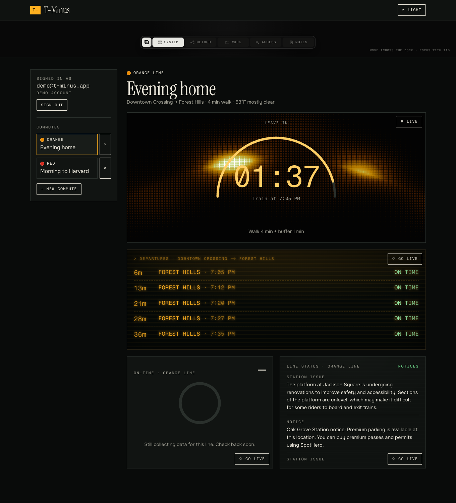
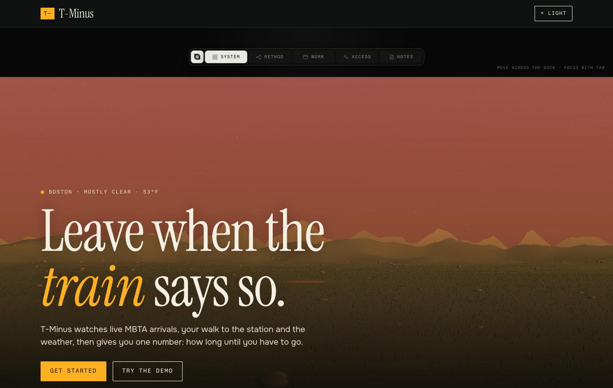
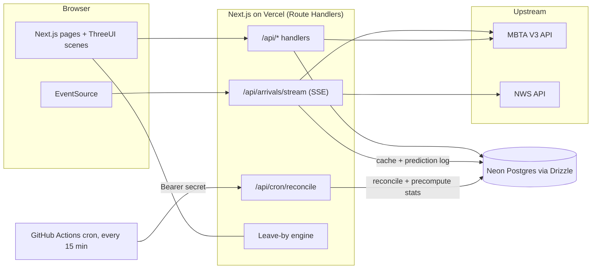

# T-Minus

**Live site:** https://t-minus-drab.vercel.app · **Code:** https://github.com/bhavishyabondalapati/t-minus



T-Minus is a live Boston commute site. It reads real MBTA arrivals and the National Weather Service forecast, subtracts your walking time and a weather buffer, and shows one number: how long until you have to leave. It also logs every prediction, checks it against when the train really arrived, and publishes the average delay by line and hour.

Try it without signing up: press **Try the demo** on the home page.



## Architecture



The MBTA key and all upstream calls stay on the server. Upstream responses are cached in Postgres with short TTLs (predictions 10 s, alerts 60 s, weather 10 min, stops and lines 24 h). If an upstream call fails, the last cached copy is served and flagged as stale. If there is no copy, the endpoint returns an empty, clearly labelled result instead of an error page.

## Tools and libraries, and why

| Tool | Why |
| --- | --- |
| Next.js 16 (App Router, Route Handlers) | One codebase for pages and the backend, and it deploys to Vercel with no config. |
| TypeScript | Catches mistakes in the engine and API shapes before they run. |
| Neon Postgres + Drizzle ORM | Serverless Postgres that works over HTTP from Vercel, with typed queries and SQL migrations kept in git. |
| `@node-rs/argon2` | argon2id password hashing with prebuilt binaries, so it installs on Vercel without compiling. |
| zod | One place to validate every request body and query string. |
| ThreeUI Community (`@designcodeio/threeui`, MIT) | Free shader scenes and controls: Landscape, Animated Top Dock, CRT Terminal, Predictive Arc, Performance Gauges, Diagnostics Panel, Uplink Loader and the liquid-metal Get Started button. |
| Vitest | Fast unit tests for the engine, validation and stats. |
| Playwright | Real-browser end-to-end test of demo login, saving a commute and seeing the countdown. |
| GitHub Actions | CI (lint, typecheck, tests, build) and the scheduled reliability job. |
| Instrument Serif, Fragment Mono, Onest | A display serif, a mono for numbers and labels, and a plain readable body font. All SIL OFL. |

## File structure

```
.github/workflows/ci.yml          Lint, typecheck, unit tests and build on every push and PR
.github/workflows/e2e.yml         Manual run of the Playwright suite against a deployed URL
.github/workflows/reliability.yml Every 15 min: calls the protected reconcile endpoint
DECISIONS.md                      Log of every non-obvious decision and why
docs/                             README screenshots
drizzle/                          Generated SQL migrations
e2e/commute.spec.ts               Playwright: demo login, save commute, countdown, headers, auth guard
public/landscape.html             ThreeUI landscape scene document (MIT), served same-origin
scripts/seed.ts                   Creates the demo account and two sample commutes
scripts/screenshots.mjs           Regenerates the README screenshots
src/app/layout.tsx                Fonts, theme bootstrap, nav and footer
src/app/globals.css               Design tokens, light and dark themes, all component styles
src/app/page.tsx                  Landing page
src/app/app/page.tsx              Signed-in dashboard (server side session check)
src/app/login, signup/page.tsx    Auth pages
src/app/reliability/page.tsx      Average delay by line and hour
src/app/api/auth/*                Signup, login, logout, demo login, current user
src/app/api/commutes/*            Saved commutes: list, create, delete
src/app/api/lines/*               MBTA lines and stops (cached)
src/app/api/arrivals/stream       Server-Sent Events: live predictions plus weather
src/app/api/alerts, weather       Cached alerts and weather
src/app/api/reliability           Precomputed delay stats
src/app/api/cron/reconcile        Protected job: poll, reconcile, recompute stats, purge
src/lib/leave-by.ts               Pure leave-by engine and weather helpers (unit tested)
src/lib/validation.ts             zod schemas
src/lib/scene-manager.ts          Keeps exactly one WebGL scene running
src/lib/use-scene-slot.ts         Hook: a scene competes for the slot only while on screen
src/lib/use-arrivals.ts           Hook: EventSource subscription and clock
src/lib/db/schema.ts, index.ts    Drizzle tables and Neon client
src/lib/server/mbta.ts, nws.ts    Upstream clients (server only)
src/lib/server/cache.ts           Postgres read-through cache with stale fallback
src/lib/server/rate-limit.ts      Postgres fixed-window rate limiter
src/lib/server/auth.ts            argon2, sessions, httpOnly cookie
src/lib/server/prediction-log.ts  Logging, reconciliation and stats SQL
src/components/                   Nav, footer, Scene wrapper, posters, panels, dashboard, forms
src/components/live/              Lazy-loaded ThreeUI wrappers (one file per scene)
tests/                            Vitest unit tests
```

## Setup

The project uses a conda environment named after the folder, which provides Node 22.

```bash
conda create -n t-minus -c conda-forge nodejs=22 -y
conda activate t-minus
npm install
cp .env.example .env.local   # then fill in the values
```

Environment variables (`.env.local`, never committed):

| Name | What |
| --- | --- |
| `DATABASE_URL` | Neon connection string |
| `MBTA_API_KEY` | Free key from https://api-v3.mbta.com/portal |
| `CRON_SECRET` | Random secret for the scheduled job. Generate with `openssl rand -hex 32` |

Create the tables and the demo account:

```bash
npm run db:migrate
npm run db:seed
```

## How to run it

```bash
npm run dev          # http://localhost:3000
```

Tests and checks:

```bash
npm test             # Vitest unit tests
npm run lint
npm run typecheck
npm run test:e2e     # Playwright (builds and starts the app; needs .env.local and `npx playwright install chromium` once)
```

Trigger the reliability job by hand:

```bash
curl -X POST -H "Authorization: Bearer $CRON_SECRET" http://localhost:3000/api/cron/reconcile
```

## How it was built

1. Scaffolded Next.js and chose the stack. Verified that ThreeUI's Community package is free (MIT) and contains every component needed.
2. Designed the Postgres schema (users, sessions, commutes, cache, rate limits, prediction log, delay stats) and ran the first migration on Neon.
3. Wrote the leave-by engine as pure functions first, with 40+ unit tests, before any UI.
4. Built the aggregator: MBTA and NWS clients behind a Postgres cache with stale fallback and a rate limiter.
5. Added auth (argon2, hashed session tokens, httpOnly cookie, zod, rate-limited login) and the demo account.
6. Added saved commutes and the Server-Sent Events stream.
7. Added prediction logging, reconciliation against vehicle positions, and the protected cron endpoint that precomputes the stats.
8. Built the front end: design tokens, light and dark themes, the scene manager, and one wrapper per ThreeUI component, with real data drawn as accessible text on top of each scene.
9. Added Playwright, CI, security headers and a CSP, then ran Lighthouse and fixed the accessibility findings.
10. Pushed to GitHub, deployed to Vercel and scheduled the job.

## Key concepts

- **Leave-by time** = boarding time − walking time − weather buffer − 1 min safety. Rain adds 2 min, snow 4, storms 5, plus 1 when precipitation chance is 70% or more. It works in epoch milliseconds, so daylight-saving changes cannot break it.
- **Server-Sent Events (SSE)** are a one-way stream from server to browser over plain HTTP. Simpler than WebSockets when only the server talks. `EventSource` reconnects by itself, which is how a serverless function with a 60 s limit can feel continuous.
- **Read-through cache with stale fallback** protects the MBTA rate limit and keeps the site useful when the MBTA is down.
- **Fixed-window rate limiting** counts requests per key per time window in a table. Cheap, good enough, and works on serverless where memory is not shared.
- **Password and session safety:** argon2id hashes, a constant-time dummy verify for unknown emails, session tokens stored only as SHA-256 hashes, httpOnly + SameSite cookies, rate-limited login.
- **Reconciliation:** a prediction is compared with the first moment its vehicle is seen stopped at the platform. If that is never seen, the last prediction before it vanished is used and marked as such. Delay is measured against the schedule.
- **One WebGL scene at a time:** a small store decides which on-screen scene may run. Everything else shows a static image. Phones and `prefers-reduced-motion` users always get images.
- **CSP:** a content security policy that only allows our own scripts, styles, frames and connections, plus Google Fonts for the ThreeUI loader.

## Quality

- **Lighthouse (production build, landing page):** 100 on all four categories, mobile and desktop (measured on the live site).
- **Accessibility:** skip link, keyboard-reachable everything, labelled form fields, live regions for status, text alternatives for every scene, light and dark themes with checked contrast, reduced-motion support.
- **Security:** CSP, HSTS, `X-Content-Type-Options`, `X-Frame-Options`, referrer and permissions policies; zod on every input; rate limits on auth, API and SSE; the MBTA key never reaches the browser; no secrets in git.

## Known limits

- Direction is inferred from stop order. On the Red Line's Ashmont and Braintree branches that can pick the wrong direction for some pairs.
- Weather is one forecast for downtown Boston, not per stop.
- Only subway and light rail lines are offered. Commuter rail and buses are not.
- Reliability stats start empty and fill in as the 15-minute job logs arrivals. Early numbers rest on few samples, and the page shows the sample count.
- The ThreeUI scenes carry fixed content (for example the gauge dial), so real values are shown as text next to them rather than driving the dial.
- A Vercel function can stream for at most 60 s, so the browser reconnects about once a minute.
- The demo account is shared. Anyone using it can add or delete its commutes, and `npm run db:seed` resets it.
- The Playwright suite stubs the live feed so it is deterministic. It is not run in CI automatically because it signs in against a real database.

## Credits

- Scenes and controls: [ThreeUI](https://threeui.com) Community by Meng To, MIT license (https://github.com/MengTo/threeui). The catalog thumbnails on threeui.com are not MIT and are not used.
- Data: [MBTA V3 API](https://www.mbta.com/developers/v3-api) and the [National Weather Service API](https://www.weather.gov/documentation/services-web-api). This project is not affiliated with the MBTA.
- Fonts: Instrument Serif, Fragment Mono and Onest, SIL Open Font License.
